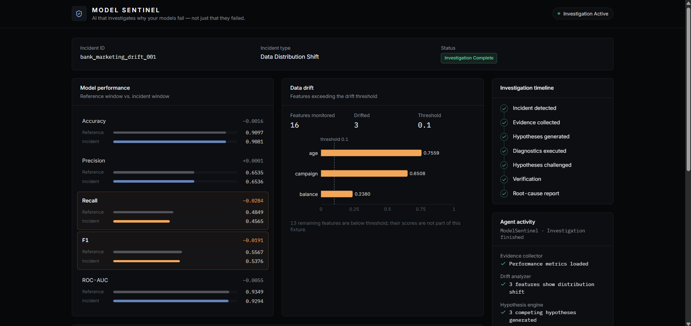
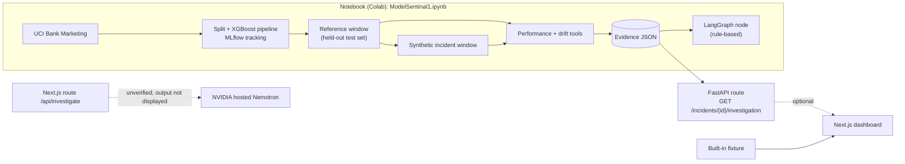
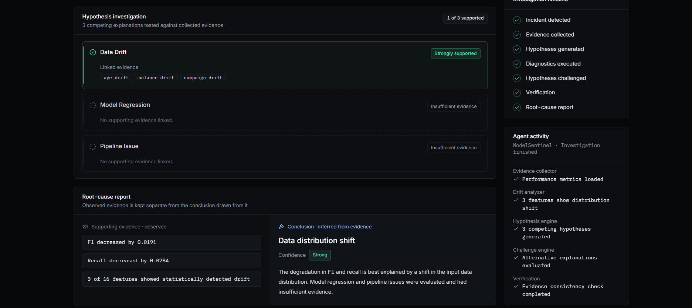

# ModelSentinel

**AI that investigates why your models fail — not just that they failed.**


> **Prototype status.** ModelSentinel is a hackathon prototype demonstrating one reproducible incident scenario end to end. Parts of the investigation logic are static or hard-coded, the NVIDIA Nemotron integration is an **untested scaffold**, and Nebius Token Factory was **not integrated**. The sections [Status and Limitations](#status-and-limitations) and [Hackathon Information](#hackathon-information) state exactly what works. This project is not production-ready.



## Contents

[Overview](#overview) · [Key Features](#key-features) · [Architecture and Workflow](#architecture-and-workflow) · [Technology Stack](#technology-stack) · [Dataset and Experimental Setup](#dataset-and-experimental-setup) · [Results](#results) · [Investigation Details](#investigation-details) · [Getting Started](#getting-started) · [Status and Limitations](#status-and-limitations) · [Future Improvements](#future-improvements) · [Hackathon Information](#hackathon-information) · [License](#license)

---

## Overview

**The problem.** Model monitoring tells you *that* something changed: a metric dropped or a distribution moved. The harder question is *why*. During an incident, an engineer has to correlate performance metrics, input distributions, validation results, and pipeline or model changes across several tools, then decide which explanation the evidence actually supports. That reasoning is manual and rarely recorded in a reviewable form.

**What ModelSentinel does.** It turns scattered signals into structured, reviewable evidence tied to competing hypotheses:

1. Diagnostic tools compare a **reference window** against an **incident window**, producing machine-readable performance and feature-drift evidence.
2. The evidence is framed against candidate causes (data drift, model regression, pipeline issue) rather than assuming one.
3. A Next.js dashboard presents the evidence, the hypotheses, and a root-cause report that keeps **observed facts separate from the conclusion drawn from them**, with a stated confidence level.

**Why the approach is useful.** Evidence is generated by deterministic tools, so any LLM reasoning added later can be grounded in recorded numbers instead of free-form guesses. A single typed data contract (TypeScript types in the UI, mirrored by Pydantic schemas in the API) keeps the dashboard independent of where the data comes from.

**Current scope.** One scenario, `bank_marketing_drift_001`: an XGBoost classifier on the UCI Bank Marketing dataset, evaluated on a clean window and on a copy with a controlled covariate shift injected into three features.

## Key Features

| Capability | Status | Notes |
|---|---|---|
| XGBoost baseline in a scikit-learn pipeline | Implemented | Notebook; stratified split. |
| Schema validation (Pandera) | Implemented | Run once on the raw dataset; not applied to the incident window. |
| Experiment tracking (MLflow, SQLite) | Implemented | Parameters, metrics, and model logged and reloaded. |
| Reference vs. incident evaluation | Implemented | Five metrics on a held-out set and a synthetically shifted copy. |
| Performance and drift diagnostic tools | Implemented | Evidently-based drift tool, threshold 0.1; both write JSON evidence. |
| Next.js investigation dashboard | Implemented | Runs from a built-in fixture; can optionally read from the API. |
| FastAPI service | Partial | One endpoint. Metrics and drift come from the evidence file; hypotheses, steps, and report wording are static. Defined inside the notebook, not as repository files. |
| LangGraph investigation workflow | Partial | A single rule-based node with hard-coded hypothesis statuses and conclusion. |
| NVIDIA Nemotron via hosted API | Stub | Integration scaffold added (`app/api/investigate/route.ts`); inference not yet verified. |
| Evidence-grounded LLM reasoning | Planned | A prompt template exists in the notebook but is never sent to a model. |
| Counterfactual verification, report export | Planned | The UI shows a verification stage; no corresponding logic exists. |

## Architecture and Workflow



The LangGraph output is **not consumed by the API or the dashboard**. The API builds its response directly from the evidence file. By default the dashboard renders the built-in fixture; setting `NEXT_PUBLIC_API_BASE_URL` makes it fetch from the API instead.

**Which investigation stages are real?**

| Dashboard stage | Reality in the code |
|---|---|
| Incident detected | Not automatic. The incident is created by perturbing a copy of the test set. |
| Evidence collected | **Real.** Performance and drift tools produce the evidence JSON. |
| Hypotheses generated | Static. Three fixed hypotheses (data drift, model regression, pipeline issue). |
| Diagnostics executed | **Real for performance and drift only.** None exist for model regression or pipeline issues. |
| Hypotheses challenged | Presentational; no challenge logic. |
| Verification | Static record written by the LangGraph node. |
| Root-cause report | Template text plus numbers from the evidence (API) or the fixture. |

"Model regression" and "pipeline issue" are shown as *insufficient evidence* because no model-version or pipeline-change data is supplied, not because tests ruled them out.

## Technology Stack

| Area | Technologies |
|---|---|
| Modeling and evidence (notebook) | pandas, NumPy, scikit-learn, SciPy, XGBoost, MLflow 3.16.1, Evidently 0.7.23, Pandera 0.33.1 |
| Orchestration and API | LangGraph (single node), FastAPI, Uvicorn, Pydantic |
| Frontend | Next.js 14.2.15 (App Router), React 18, TypeScript, Tailwind CSS, Recharts, lucide-react |
| Runtime | Google Colab and Google Drive for the notebook; Node.js for the dashboard |

Installed but unused in the recorded workflow: DuckDB and Plotly. Streamlit is not used (an empty directory is created by the notebook). Library versions not listed above were not recorded in the notebook output.

## Dataset and Experimental Setup

**Dataset.** [UCI Bank Marketing](https://archive.ics.uci.edu/dataset/222/bank+marketing) (`bank-full.csv`): **45,211 records, 17 columns** (16 input features + target `y`). No missing values. Target counts: **39,922 `no` (88.30%) and 5,289 `yes` (11.70%)**.

**Split and model.** Stratified 80/20 split with `random_state=42` (36,168 train / 9,043 test). Preprocessing: median imputation for the 7 numerical features (no scaling); most-frequent imputation and one-hot encoding (`handle_unknown="ignore"`) for the 9 categorical features. Model: `XGBClassifier` (`n_estimators=300`, `max_depth=6`, `learning_rate=0.05`, `subsample=0.8`, `colsample_bytree=0.8`, `random_state=42`), default 0.5 decision threshold, no class weighting or threshold tuning.

**Reference and incident windows.** The reference window is the 9,043-row held-out test set, so the "normal" evaluation is numerically identical to the baseline test evaluation. The incident window is a copy with labels unchanged and a controlled covariate shift:

| Feature | Perturbation | Mean, reference to incident |
|---|---|---|
| `age` | +8 | 41.11 to 49.11 |
| `balance` | x 1.5 | 1349.39 to 2024.08 |
| `campaign` | +2 | 2.76 to 4.76 |

**Limitation: `duration`.** The model uses the `duration` feature. The UCI dataset documentation cautions that call duration is not known before a call and should be discarded for realistic predictive models. The notebook keeps it, so absolute metrics are not those of a deployable model. The reference-versus-incident comparison is unaffected in kind, since both windows use the same model.

**Citation.** S. Moro, P. Cortez, P. Rita. *A data-driven approach to predict the success of bank telemarketing.* Decision Support Systems, 2014.

## Results

### Model performance

| Metric | Normal (reference) | Incident | Change |
|---|---|---|---|
| Accuracy | 0.9097 | 0.9081 | -0.0015 |
| Precision | 0.6535 | 0.6536 | +0.0001 |
| Recall | 0.4849 | 0.4565 | -0.0284 |
| F1-score | 0.5567 | 0.5376 | -0.0191 |
| ROC-AUC | 0.9349 | 0.9294 | -0.0055 |

The injected shift caused a **small, recall-concentrated degradation**. Recall fell by 0.0284, about 30 fewer true positives out of 1,058 positives in the test set (derived from the class balance). Precision was unchanged and accuracy moved by only 0.0015, so accuracy alone would not have signalled the incident. The baseline itself is a moderate classifier for the minority class (recall 0.4849 at the default threshold). These are single-run results with no confidence intervals or significance testing.

### Drift detection

Evidently's `DataDriftPreset` compares incident features against reference features (target excluded), using a normalized Wasserstein distance for numerical features and Jensen-Shannon distance for categorical ones, with a threshold of 0.1.

| Feature | Drift score | Exceeds 0.1 |
|---|---|---|
| `age` | 0.7559 | Yes |
| `campaign` | 0.6508 | Yes |
| `balance` | 0.2380 | Yes |

3 of 16 features exceeded the threshold; the other 13 fell below it (the unperturbed numerical features `day`, `duration`, `pdays`, and `previous` scored 0.0). The scores are normalized distances against a fixed threshold, not significance tests.

> **Interpretation.** This is **one synthetic incident scenario**, and the three drifted features are exactly the three that were perturbed. The result shows that the drift tool detects a known, deliberate shift. It is **not evidence of general root-cause detection accuracy**.

## Investigation Details

The root-cause report separates observed evidence from the inferred conclusion, and reports a confidence level. In the current implementation, the confidence and the hypothesis statuses are fixed values rather than outputs of an evaluation of the evidence.



## Getting Started

### Run the dashboard (fixture mode)

Prerequisite: Node.js 18.17 or newer.

```bash
git clone https://github.com/anoophundal/modelsentinal.git
cd modelsentinal
npm install
npm run dev
```

Open [http://localhost:3000](http://localhost:3000). The dashboard works in **fixture mode** without any backend: it renders the built-in `bank_marketing_drift_001` data. Building the app downloads Inter and IBM Plex Mono through `next/font/google`, so it needs internet access.

### NVIDIA API key (optional, unverified)

The repository includes an inference route scaffold at `app/api/investigate/route.ts`, which makes a server-side request to NVIDIA's hosted inference API with the model ID `nvidia/nemotron-3.5-super-vl-120b-a12b`. **This route has not been tested, and a successful inference response has not been verified or displayed in the dashboard.** The dashboard's investigation content comes from the fixture, not from the model.

To experiment locally, create a `.env.local` file in the project root:

```bash
NVIDIA_API_KEY=<your key>
```

`.env.local` is local-only and **must never be committed**; make sure `.env*.local` is excluded by git before you commit. The author's key is stored locally and is not part of this repository. Restart `npm run dev` after changing environment variables.

### Reproduce the evidence (notebook)

`ModelSentinal1.ipynb` is written for Google Colab with Google Drive mounted at `/content/drive/MyDrive/ModelSentinel`.

- Mount Drive before running the first cell; the mount cell appears later in the notebook than cells that already write to Drive.
- The cell that loads the model uses a hard-coded MLflow run ID (`runs:/957c9a69.../baseline_model`) from the original tracking database. After a fresh run, replace it with the run ID printed by the logging cell.
- There is no `requirements.txt`. The Evidently code uses the v0.7 API.

### Optional technical notes: FastAPI backend

The API is defined inside the notebook, which writes `app/api/main.py` to Drive; it is not a standalone file in this repository and is **not a simple setup**. It exposes `GET /` and `GET /incidents/{incident_id}/investigation`, and reads the evidence file from a hard-coded Colab path. Running it elsewhere requires copying the file and the evidence JSON out of Drive and editing that path. With the API running, start the dashboard with `NEXT_PUBLIC_API_BASE_URL=http://127.0.0.1:8000 npm run dev`.

Known differences from the fixture when using the live API: it reports `featureCount` as 3 (the drifted count) while the UI labels it "Features monitored", and `incident.type` appears as `data_drift`. In the notebook, the API was exposed through a temporary Cloudflare quick tunnel; only the health-check route was verified through it, and tunnel URLs are ephemeral.

## Status and Limitations

- **Single, synthetic scenario.** One dataset, one model, one injected covariate shift, one run. The cause is known by construction.
- **Hard-coded investigation logic.** Hypotheses, verification, confidence, and report wording are fixed; the LangGraph node does not evaluate evidence, and its output is unused.
- **Correlational conclusion.** The data-drift explanation rests on coincident degradation and detected distribution change; counterfactual verification has not been done.
- **Limited backend.** The FastAPI service exists only inside the notebook, with hard-coded Colab paths.
- **NVIDIA inference unverified.** The Nemotron route is a scaffold; no successful response has been confirmed.
- **No Nebius integration.** See [Hackathon Information](#hackathon-information).
- **Not deployed and untested.** No production deployment, automated tests, CI, container configuration, or API authentication. The dashboard is hard-wired to a single incident ID.

## Future Improvements

- Evidence-grounded LLM reasoning that consumes the recorded evidence JSON, once the NVIDIA inference route is verified.
- Counterfactual verification, such as re-evaluating with drifted features restored.
- Real diagnostics for model regression (model-version comparison) and pipeline issues (schema and null checks on the incident window).
- More incident types (label shift, missing values, schema breaks) with known ground truth, to measure root-cause attribution accuracy.
- Support for multiple incidents in the dashboard.
- Proper backend packaging with pinned requirements, tests, and CI.

## Hackathon Information

**Event:** Nebius × NVIDIA Global AI Hackathon 2026
**Repository owner:** Anoop Kaur Hundal ([`anoophundal`](https://github.com/anoophundal))

| Sponsor technology | State in this project |
|---|---|
| NVIDIA Nemotron (`nvidia/nemotron-3.5-super-vl-120b-a12b`, hosted API) | Integration scaffold added; inference not yet verified. The model is not powering the investigation workflow. |
| Nebius Token Factory | **Not integrated.** Access was blocked by mandatory payment-card verification, so the integration could not be completed. The project does not run on Nebius infrastructure. A client scaffold in the notebook (`NEBIUS_API_KEY`) makes no requests. |

This submission does not claim that all sponsor requirements have been fulfilled.

## License

Released under the [MIT License](LICENSE). Copyright (c) 2026 Anoop Kaur Hundal.
